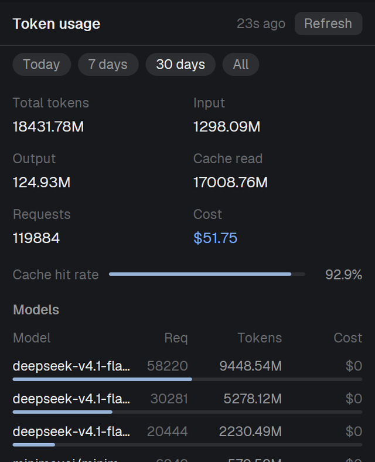

# Herdr agent panels

Four [Herdr](https://herdr.dev) **desktop-app mods** (herdr-app `mods/`, plain JavaScript + `gpui-kit`)
that add the three panels everyone keeps rebuilding, plus the button bar that switches them:

| mod | panel | what it shows |
| --- | --- | --- |
| [`token-usage`](token-usage/) | Usage | Live omp token/cost panel: today / 7 days / 30 days / all, per model and per project, cache-hit rate, request counts, spend. Indexes the omp session store incrementally (1342 files / 1.8 GB warm in seconds). |
| [`convo-log`](convo-log/) | Log | Records what every agent pane has shown into append-only logs, with dedup, and reads them back (last 400 lines / all). Per-pane capture, auto-capture off by default. |
| [`task-sched`](task-sched/) | Cron | Recurring agent tasks: a prompt, an interval, a folder — it opens a tab and starts the agent you configure, while the app window is open. |
| [`panel-buttons`](panel-buttons/) | — | The three toggles (Usage / Log / Cron) for the docked panel stack. |



**Why app mods:** the community plugins for these three jobs (token dashboards, session
transcripts, scheduled agents) declare `platforms = ["linux", "macos"]` today, so
`herdr plugin action invoke` refuses them on Windows. These are herdr-app mods: the same
JavaScript runs on Windows, macOS and Linux, and there is no platform gate to trip.

## Install

Paste this to your agent (it reads the app's own mod rules and fits the mod to your setup):

```
Read ~/.config/herdr-app/AGENTS.md, then add this mod: https://github.com/nakamotosai/herdr-agent-panels/<mod>
```

Or by hand: copy `<mod>/mods/<name>/` into `~/.config/herdr-app/mods/<name>/` and run
`herdr-app check ~/.config/herdr-app/mods/<name>`. Each folder here also has the `RECIPE.md`
(the brief another agent can rebuild the mod from an empty folder) and `preview.png`.

## Showing them

**One-line dock.** Set the panel's `mod.json` to `{"place": "right", "size": 400}`: the app
docks it as its own right-hand column the first time it sees the folder. Three panels = three
columns, so most people want the stack below instead.

**One panel, three views (what the screenshots show).** Put a column in your layout whose stack
holds the three panels, then switch with the buttons:

```json
{ "id": "sai-panel", "type": "column", "size": { "px": 400 }, "min": 260, "max": 760,
  "children": [
    { "id": "sai-panel-body", "type": "stack", "active": "token-usage",
      "children": [
        { "id": "token-usage", "type": "block", "content": { "mod": "token-usage" } },
        { "id": "convo-log",   "type": "block", "content": { "mod": "convo-log" } },
        { "id": "task-sched",  "type": "block", "content": { "mod": "task-sched" } } ] } ] }
```

Hide/show it from the command line or from a key: `herdr-app do layout.hide --id sai-panel` /
`layout.show --id sai-panel`. Switching which panel shows is three commands, because the app
records a stack child you switch away from as `hidden` and `layout.select` alone does not clear
that:

```sh
herdr-app do layout.select --stack sai-panel-body --child convo-log
herdr-app do layout.show --id convo-log
herdr-app do layout.show --id sai-panel
```

The shipped layouts are read-only, so put this in a layout you own
(`herdr-app do layout.clone --name main --as dashboard`, then edit `layouts/dashboard.json`).

**Buttons.** `mods/panel-buttons/` draws the three toggles with no other dependency; give it
`props` to point at your own ids. Place it as a block inside your top strip, or as a floating
block (`"floating": [{ "id": "panel-buttons", "content": { "mod": "panel-buttons" },
"edge": "top", "align": "end" }]` on the root).

To get the buttons *inside* the shipped tab bar (exactly the look in the screenshots), clone it
on your own machine and add one module — `extras/tabbar-buttons.js` carries the two lines it
needs (`import` + `.child(quickButtons())`); Herdr's own tab bar stays untouched in this repo:

```sh
herdr-app do mod.clone --name tabs --as tabs-sai
cp extras/tabbar-buttons.js ~/.config/herdr-app/mods/tabs-sai/quick-buttons.js
# then add the import and the .child(quickButtons()) line to mods/tabs-sai/main.js
# and point the layout's tabs block at "tabs-sai"
```

## What they read and run (disclose before installing)

| mod | reads | runs |
| --- | --- | --- |
| `token-usage` | `~/.omp/agent/sessions/**/*.jsonl` (omp's session store; **not** the stale `~/.omp/stats.db`) | `powershell` (Windows) or `find` (Unix) to list that folder |
| `convo-log` | your agent panes' screens, via `hc read <address> --lines 600` | `hc`, and `explorer` for "open folder"; writes `~/.config/herdr-app/data/convo-log/` |
| `task-sched` | `~/.config/herdr-app/data/task-sched/{tasks.json,runs.log}` | `tab.new` → starts whatever `argv` you configure (real agents, real folders) |
| `panel-buttons` | the shown layout | `layout.select` / `layout.show` / `layout.hide`, `mod.open` |

`convo-log` logs contain whatever your panes displayed — prompts, code, tokens, secrets. It is
off until you capture, and its default is manual capture.

## Limits (by design, not bugs)

- Everything only runs while the app window is open. `task-sched` never backfills runs missed
  while it was closed (it shows `missed N` instead); for "runs with the window shut", use your
  OS scheduler with `hc run --bg`.
- `token-usage` lags the *currently writing* session by up to about a minute: files over 8 MB
  are read whole only once they have been still for 60 s, and each pass reads at most 6 MiB. It
  says so in its footer when it defers, skips or partially indexes anything.
- App mods are unsandboxed code running as you. Read `RECIPE.md` and the `main.js` first.

## Not affiliated with Herdr

Herdr's own mods are Apache-2.0 and this repo redistributes none of them: `extras/tabbar-buttons.js`
is original code that *you* drop into a clone your machine makes. License for everything here: MIT.
