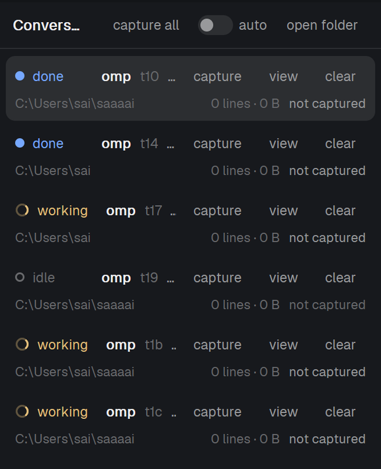

# Conversation log

A panel that keeps a written record of what each agent terminal has shown. Every
agent gets one row in a list: its status, program and address, and the space and
tab it lives in. One click captures what that terminal is showing right now into
an append-only log on disk; "capture all" walks every agent in turn, and a switch
captures the busy ones by itself every 60 seconds. "view" opens the log in a
reader window with the file name, its size and line count, a "last 400 lines / all"
toggle and a refresh button. Logs are plain text files under
`~/.config/herdr-app/data/convo-log/`, one per terminal, and they only ever grow —
this is the point of the mod, and also its sharpest edge (see **Watch out**).



## What you see

The recorder (no `props().file`):

- **Header, 40 px, `theme()` surface, a 1 px `border` bottom edge, 12 px side
  padding.** Left: the title "Conversation log", semibold, 12.5 px, `foreground`,
  one line with an ellipsis. Right, all 11.5 px `muted` text in 8 px pills that
  brighten to `hover` background and `foreground` text on hover: "capture all",
  then an "auto" switch (30×17 px track, `border` when off and `accent` when on,
  with an 11 px knob that sits left when off and right when on) and its "auto"
  label, then "open folder". While "capture all" is running a 12 px spinner
  (`working` color, 900 ms per turn) appears before the buttons.
- **Body, scrollable, 6 px padding, 2 px between rows.** One card per agent,
  8 px padding, 6 px between its two lines, rounded 8 px; the focused agent's card
  is `selected`, any card under the pointer is `hover`.
  - **Line one:** a status mark, the status word, the program name, the address,
    then the space and tab (`name · name`, truncated, `muted`), then the buttons
    "capture" / "view" / "clear". While that address is being captured the
    "capture" button is replaced by the spinner.
  - **Line two, 11 px `dim`:** the terminal's working folder (or `—` when no pane
    has it), the counters `N lines · N B` (1000 → `1k`, 10000 → `10k`,
    1e6 → `1M`, one decimal below 10k), and the last capture's wall clock as
    `HH:MM:SS`, or "not captured".
  - **Status marks:** `working` is the spinning svg; `idle` a hollow 8 px ring;
    `blocked` and `done` a filled 8 px dot in that status' theme color. The status
    word sits in a 52 px column, colored by status (`working`, `blocked`, `done`,
    `idle`, else `dim`).
- **Empty state:** "reading..." until `state.json` has been read, then "no agent
  terminals". Any error is appended below the list, in `blocked` color.

The reader (`props().file` set), opened 780×620 in-window:

- **Header, 38 px:** the title (the program name plus address the recorder passed,
  or the file name), semibold and truncated; then, 11 px `dim`, the file name,
  its size and its shown line count, with `(of N)` when only the tail is shown;
  then the buttons "last 400 lines" / "all", "refresh" and "✕".
- **Body, scrollable, 6 px vertical padding:** the log's lines, 12 px, in the
  settings' font family when one is set, 12 px side padding, wrapped, one GPUI
  element per line (`log-0`, `log-1`, …). Lines starting with `=====` (the capture
  headers) are `accent`; everything else is `foreground`; empty lines become a
  single space.
- **Empty states:** "reading..." while the file has not come back, "log is empty"
  when it read but has no lines; read errors in `blocked` color.

## How it behaves

- **Capture** reads the terminal with `hc read <address> --lines 600`, aligns the
  600 lines against the tail remembered for that address, and appends only the
  lines that are new (see the dedup rule in **Watch out**). The address may be
  remote (`vps-jp/t7`), in which case `hc` goes to that machine. The block written
  is `\n===== 2026-10-31 05:41:02 · working =====\n<new lines>\n` — the timestamp is
  local time, the word is the agent's status at that moment (`unknown` when the
  agent is gone).
- **"capture all"** captures each agent of `agents()` in list order, one after the
  other, each row marking itself busy as its turn comes. Running it twice at once
  does nothing the second time. The header spinner and the per-row spinners track
  it.
- **"auto"** (off by default, and the setting is remembered in `state.json`) runs
  the same walk every 60 000 ms, and only if at least one agent is not `idle` —
  an all-idle screen is skipped entirely.
- **"capture"** does one address; a second click while it is running is ignored.
- **"view"** opens an overlay of this same mod (`kind: "window"`, 780×620, keyed
  by the address, not kept) with `props.file` pointing at that address' log.
- **"clear"** writes that address' log as an empty file, zeroes its counters and
  forgets its dedup tail; the next capture starts a fresh file.
- **"open folder"** runs `explorer` on the data folder (backslashes), so the logs
  can be opened in the file manager.
- **Refresh** in the reader re-reads the file; there is no auto-refresh, and the
  reader never writes.
- On load the mod reads `state.json`; if a log exists whose counters are missing
  or out of step (the file was deleted by hand, an earlier write failed), it
  recounts that log's lines and bytes from the file. Addresses come from both the
  bookkeeping and the live agents.
- Nothing moves by itself, there are no keys, and no animation beyond the
  spinners.

## Built from

One folder with one file plus its manifest: `mods/convo-log/main.js` (a single
`View`) and `mods/convo-log/mod.json`.

- `mod.json`: `{"place":"none","overlay":{"width":560,"height":460}}` — nothing
  docks it by itself, and `mod.open {"name":"convo-log"}` opens it as a 560×460
  overlay. The "view" overlays are 780×620 and are opened by the mod itself.
- `herdr` functions used: `agents()` (address, status, program, space/tab names,
  focused), `panes()` (to find an address' `cwd`), `hc(["read", …])` for the
  screen, `exec("explorer", …)`, `openOverlay` / `closeOverlay`, `props()`,
  `theme()`, `settings()` (the reader's mono font), `appHome()`.
- `gpui-kit`: `View`, `div`, `svg`; `gpui-base`: `v_flex`, `h_flex`, `Switch`. The
  spinner is `mods/workspace-chrome/spinner.svg`, sized 12 and colored `working`.
- Colors come from `theme()` only: `surface`, `foreground`, `border`, `muted`,
  `dim`, `hover`, `selected`, `accent`, `accent_foreground`, and the status colors
  `working`, `blocked`, `done`, `idle`.
- Programs run: **`hc`** (one `hc read <address> --lines 600` per capture, which on
  a remote address runs against that machine) and **`explorer`** (the folder
  button). Nothing else is executed; no network access of its own.
- Files touched, all under `~/.config/herdr-app/data/convo-log/`:
  - `state.json` — `{"auto": bool, "last": {"<address>": {"hash", "lines": [...800
    lines], "at": <ms>}}, "totals": {"<address>": {"lines", "bytes"}}}`; written
    pretty-printed with a trailing newline after every capture and on every toggle.
  - `<machine>/<file>.log` — one text file per terminal. A local address `t10`
    lands in `local/t10.log`; a remote address `vps-jp/t7` lands in
    `vps-jp/vps-jp_t7.log` (the machine is also the folder, and slashes in the
    address become underscores).
- `fs/promises` only: `readFile`, `writeFile`, `mkdir`, `exists`.

## Watch out

- **The logs contain whatever the agent panes displayed — prompts, source code,
  terminal output, and any token, key or password that ever scrolled past.** They
  are plain text, they are never pruned, and they are written outside the mod
  folder (`~/.config/herdr-app/data/convo-log/`). Do not commit them, do not share
  them, and say this out loud to whoever installs the mod. "clear" is the only
  thing that removes an address' log.
- **`fs/promises` in the gpui-shell runtime has no `appendFile`.** Every append is
  read-the-whole-log-then-write-it-back, so one capture costs one full read and
  one full write of that address' log. There is no `stat` either, which is why
  sizes and line counts live in `state.json` and are recounted from the files on
  load. A log grows by at most 8 kB per capture, so this stays cheap — but it does
  grow without bound, and a very long log makes every later capture heavier.
- **The 8 kB per-append cap.** If the new part of a capture is bigger than
  8 KiB minus the header, only its last lines are written and the block starts
  with `... first N lines of this capture exceeded 8 kB and were not recorded`.
  The marker is included in the budget, so the cap always holds.
- **Dedup rule** (what counts as "new"): the fresh 600 lines are aligned with the
  tail remembered for that address two ways — a sliding window (the remembered
  tail's end matching this read's start, needing at least 2 overlapping lines, or
  exactly the whole read; the terminal scrolled) and a changed hunk (the common
  prefix plus common suffix around the two ends; the middle stretch is new). The
  alignment that recognizes more lines wins; anything left is appended. When
  neither end lines up (clear screen, program restart, full repaint) the whole
  capture is treated as new and written whole. One or two lines of coincidence are
  not enough to count.
- **Remote addresses** look like `machine/t7` and go through `hc` to that machine;
  local ones have no prefix. `hc read` gives the terminal's last 600 lines, so a
  burst longer than 600 lines between two captures cannot be recovered by the
  next one.
- **`explorer` is Windows-only**, and the path handed to it uses backslashes; on
  another OS the folder button simply fails in `exec`.
- **No keys, no `keys.json`.** The mod binds nothing.
- **Whoever installs this should be told it runs programs** (`hc`, `explorer`) and
  reads loose files (`state.json`, the logs) outside its own folder — the two
  things the app asks people to warn about.
- `appHome()` is the app's home (`~/.config/herdr-app`), not the user's home.

## Done when

- `herdr-app check "<folder>"` prints `check passed: <folder>` and exits 0.
- `herdr-app do mod.open '{"name":"convo-log"}'` shows the recorder: one card per
  agent with the status word (`working` / `blocked` / `done` / `idle`), the program
  name, the address, `space · tab`, the three buttons, and the second line with the
  folder, `N lines · N B` and either a `HH:MM:SS` time or "not captured". With the
  app just started, a card reads `0 lines · 0 B` and "not captured".
- Press "capture" on a non-idle agent: the button turns into a spinner, then the
  counters rise and the time appears; the file
  `~/.config/herdr-app/data/convo-log/<machine>/<file>.log` now exists and its
  first line is `===== <timestamp> · <status> =====`; `state.json` has that address
  under `last` and `totals`.
- Press "capture" again without touching that terminal: the counters do not move
  and the log gains nothing — the dedup reused the whole screen.
- Scroll or run something in that terminal and capture again: exactly the new
  tail is appended as a second block.
- Press "view": a 780×620 overlay shows that log with the file name, its size and
  line count; "last 400 lines" / "all" toggles between the tail and the whole file
  (with `(of N)` appearing) and re-renders; "refresh" picks up a capture made in
  the meantime.
- Press "clear": the counters drop to `0 lines · 0 B`, the time disappears, and the
  log file is empty; the next capture starts a new block from scratch.
- Turn "auto" on, leave a busy agent running: within about a minute its counters
  and time move by themselves; an all-idle screen never triggers a capture. Reload
  the mod and the switch is still on (it was written to `state.json`).
- "capture all" marks each row busy in turn and ends with every agent captured;
  a second click while it runs is ignored.
- "open folder" opens the file manager at `~/.config/herdr-app/data/convo-log/`.

## Install

`mod.json`'s `place` is `"none"`, so the mod shows up nowhere on its own — open it
with `herdr-app do mod.open '{"name":"convo-log"}'`, or dock it in a layout. To dock
it as a right column, copy `mods/convo-log/` into the app home's `mods/` and add it
as a child of a stack in a column of your layout (400 px here, min 260, max 760 —
the panel is meant to be narrow, so give it at least ~300 px):

```json
{ "id": "sai-panel", "type": "column", "size": { "px": 400 }, "min": 260, "max": 760,
  "children": [
    { "id": "sai-panel-body", "type": "stack",
      "children": [
        { "id": "convo-log", "type": "block", "content": { "mod": "convo-log" } }
      ],
      "active": "convo-log" } ] }
```

A stack shows one child, so put a sibling block beside it and point `active` at
whichever you want shown (that is how the dashboard layout swaps between this and
its other panels). Hiding and showing it is `herdr-app do layout.hide '{"id":"convo-log"}'`
and `herdr-app do layout.show '{"id":"convo-log"}'`.

One trap when the block sits in a stack: the app records a stack child you switch away from
as `hidden`, and `layout.select` does not clear that. Showing such a panel back takes three
commands — the select, the child, then the column:

```sh
herdr-app do layout.select '{"stack":"sai-panel-body","child":"convo-log"}'
herdr-app do layout.show   '{"id":"convo-log"}'
herdr-app do layout.show   '{"id":"sai-panel"}'
```

