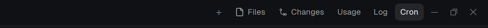

# Panel buttons

Three toggles — **Usage**, **Log**, **Cron** — for a docked panel area in the Herdr desktop
app. One press shows that panel in the stack and shows the column; pressing the button of the
panel that is already showing collapses the whole column, so one press opens and the next
closes. The preview shows them where they usually go: inside the app's own tab bar, right
after the shipped `Files` / `Changes` buttons.



## What you see

- Three pills, one per panel: 26 px high, 8 px horizontal padding, 3 px apart, 12 px text,
  rounded 6 px, `flex_none` so a long tab list never squashes them.
- The button of the panel that is showing: `theme().selected` background, `theme().foreground`
  text. The others: `theme().chrome` background, `theme().muted` text. Hover: `theme().hover`.
- With the column collapsed all three are in the muted state, so "nothing is open" and "Log is
  open" look different at a glance.
- Nothing else is drawn: no header, no icons, no background of its own — it is meant to sit in
  a strip that already has a background (the tab bar, a floating frame).

## How it behaves

- Press the button of a panel that is not showing: `setShared` records it, then
  `layout.select {stack, child}`, `layout.show {id: child}`, `layout.show {id: column}` run in
  that order. The order matters (see *Watch out*).
- Press the button of the panel that is showing: `setShared` marks the area hidden and
  `layout.hide {id: column}` runs; the stack's `active` child is left alone, so reopening shows
  the same panel again.
- Which panel is showing is tracked in `shared("panel-buttons.<panel id>")` as
  `{ panel, body, child, shown }`. Every copy of the mod reads it, so several button bars in
  one window agree.
- On the first render after a copy starts, if that shared value is missing, the mod reads the
  app's own click record (`<app home>/layouts/.state/<layout>.json`, `nodes[body].active` and
  `nodes[panel].hidden`) once and adopts it. `layout()` returns the layout file, in which a
  stack's clicked child does not appear, so the click record is the only place the truth lives.
- The whole strip is re-rendered by Herdr whenever shared state or the layout changes, so the
  highlight follows without any timer.
- A layout that has no such column or stack (this bar copied into another layout) makes a press
  fall back to `mod.open {name: <child>}` — the panel opens as its own overlay instead of
  nothing happening.

## Built from

- One mod: `mods/panel-buttons/` with `main.js` and `mod.json` (`{ "place": "none", "title":
  "Panel buttons" }`). No `layouts/` folder: a mod is a piece you add to a layout.
- `props()`: `panel` (default `"sai-panel"`), `body` (default `"sai-panel-body"`), `items`
  (default the three panels of this repo). Everything else has no configuration.
- `herdr`: `layout()`, `shared()`, `setShared()`, `readTextFile()`, `appHome()`, `run()`,
  `props()`, `theme()`. `gpui-kit`: `View`. `gpui-base`: `h_flex`.
- Commands run: `layout.select`, `layout.show`, `layout.hide`, and `mod.open` as the fallback.
- Pictures: none. No program is run, no network, no file is written; it reads one small JSON
  file once per copy start.

## Watch out

- **The three-command show.** The app records a stack child you switch away from as `hidden`,
  and `layout.select` does not clear it: select alone leaves the panel hidden. Show the child
  *and* the column. That is the bug this mod was built around, and the first version had it.
- **Clicks are not in the layout file.** `layout()` gives the layout document. A stack's
  `active` there stays whatever the file says, while the app renders the last clicked child.
  Any button that has to highlight "what is showing" must read the click record or track the
  state itself, or its highlight will lie (the first version highlighted the wrong button).
- **A strip drags the window.** In a top strip (or any `window_drag` block) a press that is not
  stopped moves the window: every button calls `cx.stop_propagation()` on
  `.on_mouse_down("left", ...)` and runs its action on click.
- **`on_click` cannot be exercised from the CLI.** `herdr-app` has no synthetic input command
  (`terminal.right_click` is the only pointer command), so a build of this mod can only be
  verified as far as: it loads, it renders (its size is reported in `herdr-app status` when it
  floats), and the exact commands its handlers run work when issued from the shell.
- Ids are props, not constants: point `panel`/`body`/`items` at your own layout nodes or the
  buttons will look for a column that is not there.
- The fallback (`mod.open`) needs the target mods to exist and to declare an overlay in their
  `mod.json`; otherwise a press does nothing visible.

## Done when

- `herdr-app check ~/.config/herdr-app/mods/panel-buttons` prints `check passed`.
- Placed as a floating block on an edge (`"floating": [{"id": "panel-buttons", "content":
  {"mod": "panel-buttons"}, "edge": "top", "align": "end"}]`) it renders: `herdr-app status`
  reports its `floats` entry with a non-zero width/height, and a shot shows the three labels.
- Pressing `Log` with the panel collapsed shows the Conversation log panel and highlights Log;
  pressing `Log` again hides the column and dims all three (verify by the same commands the
  handler runs: `layout.select` + `layout.show --id <child>` + `layout.show --id <column>`, then
  `layout.hide --id <column>`).
- With the shared value deleted (or after an app restart) the highlight matches the panel that
  is actually showing — the seed read the click record.

## Install

Put `mods/panel-buttons/` in the app home's `mods/` and place it where a block fits:

```json
{ "id": "panel-buttons", "type": "block", "size": { "px": 150 },
  "content": { "mod": "panel-buttons",
               "props": { "panel": "sai-panel", "body": "sai-panel-body",
                          "items": [ { "child": "token-usage", "label": "Usage" },
                                     { "child": "convo-log", "label": "Log" },
                                     { "child": "task-sched", "label": "Cron" } ] } } }
```

Inside the shipped tab bar (the look in the preview) it needs the tab bar's own mod to render
it, because the shipped `tabs` mod is read-only: clone it on your machine
(`herdr-app do mod.clone --name tabs --as tabs-sai`), drop `extras/tabbar-buttons.js` from this
repo into the clone as `quick-buttons.js`, and add the three lines its header names (an import,
`seedButtons(cx)` in `init`, `.child(quickButtons())` before the window buttons). Then point the
layout's tabs block at `"mod": "tabs-sai"`. Floating placement needs no fork:

```json
"floating": [ { "id": "panel-buttons", "content": { "mod": "panel-buttons" },
                "edge": "top", "align": "end" } ]
```
