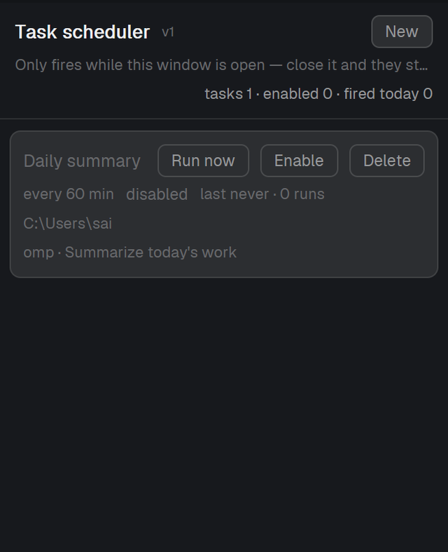

# Task scheduler

A panel that keeps a small list of recurring agent tasks and, while the Herdr window is open,
opens a new tab running an agent (or any command) in a folder on its own interval. Each row is one
task: its name, how often it runs, the folder and command it opens, when it last ran, and three
buttons — run it now, pause/resume it, delete it. The header shows the panel's honest promise
("Only fires while this window is open — close it and they stop") and a count of tasks, enabled
tasks and fires today; the footer shows how many times this window has fired something and where
the data lives. A new task is made in the panel's own form, and the first-run example ships paused
so nothing starts by itself.



## What you see

Top to bottom, in one 400 px-wide column (it also opens as a 560×460 overlay; the same layout, more
room):

- **Header** (12 px side padding, 9 px top/bottom, 1 px `border` line below). Line 1: the title
  "Task scheduler" (13.5 px, semibold, `foreground`), a small "v1" (10 px, `dim`), then on the
  right a button — "New" (or "Collapse" while the form is open) — and, when the panel is an
  overlay, an "✕" that closes it. Line 2: the hint "Only fires while this window is open — close it
  and they stop" (11 px, `dim`). Line 3, right-aligned: "tasks 3 · enabled 2 · fired today 5"
  (11 px, `muted`). The hint and the counts are on separate lines so neither is cut at 260–400 px.
- **New-task form** (only while "New" is open): a `chrome`-backed strip with labeled inputs —
  "Name", "Every (min)" (92 px wide, starts at 60), "Folder" with a "Browse" button beside it,
  "Command (space or comma separated)", "First message (optional)" — and a right-aligned "Cancel"
  and "Save" (Save filled with `solid`). Labels are 11 px `dim`; inputs are 30 px tall, 12 px text,
  `background` fill, 1 px `input` border that turns `accent` while focused.
- **Task list** (8 px padding, 6 px between cards, scrolls). Each task is a card (`raised` fill,
  1 px `border`, 8 px radius, 9 px padding), four lines:
  1. the name (12.5 px, medium — `foreground` while enabled, `dim` while paused) and, right, the
     buttons "Run now", "Disable"/"Enable", "Delete" (24 px tall, 11.5 px text, `raised` fill,
     1 px `input` border, `hover` on hover);
  2. "every 60 min" (11 px, `dim`), the countdown to the next run as `mm:ss` (11.5 px, `accent`;
     the word "disabled" in `dim` while paused), "last 14:03 · 12 runs" (11 px, `dim`), and, only
     when relevant, "missed 2" (11 px, `blocked`);
  3. the folder (11 px, `dim`, truncated with "…"; "no folder set" when empty);
  4. the command plus the first message, e.g. `omp · Summarize today's work` (11 px, `dim`,
     truncated).
  With no tasks the list shows "No tasks yet — click New above to add one." (or "Loading…"), 12 px
  `dim`.
- **Footer** (28 px tall, 1 px `border` line above, 11 px `dim`): "this window has run 3 since 09:12"
  on the left and `data/task-sched/tasks.json` on the right — replaced by the error text in
  `blocked` while something is wrong (a bad tasks.json, a failed write).

Colors all come from `theme()` (`background`, `foreground`, `raised`, `border`, `chrome`, `input`,
`hover`, `accent`, `muted`, `dim`, `solid`, `solid_foreground`, `blocked`), so the panel follows the
person's theme; text sizes are px and follow zoom.

## How it behaves

- **Firing.** Once every 15 s the panel ticks once: it re-reads `tasks.json` if the text changed,
  then fires at most one due task. A task is due when it is enabled, its last run was at least
  `every` minutes ago (or it has never run), and it has not already fired in this same minute
  (a per-task guard, so a slow write can't fire the same task twice). A fire runs
  `tab.new {name, folder, argv, task}`: a new tab named after the task's label, in that folder, with
  that command as the tab's program and the first-message field sent to it as its first message.
  It then records `lastRun`, adds one to `runs`, appends one line to `runs.log`, saves
  `tasks.json`, and posts the toast "Scheduled task started" with the task's label as its body.
- **States.** Enabled and idle: bright name, `accent` countdown. Paused: dim name, the word
  "disabled" where the countdown goes — and the row keeps showing its last run and run count.
  Working is not a state the panel knows: the fired agent runs in its own tab, and the panel only
  shows the countdown to the *next* fire. Never run yet: "last never · 0 runs". Late: "missed N"
  in `blocked` appears once a task is more than two intervals behind.
- **Clicks.** "New"/"Collapse" opens and closes the form (and clears the error line). "Browse"
  opens the native folder picker (`pickFolder`) and fills the folder field. "Save" validates
  (name, interval ≥ 1 minute, folder, folder exists, command) and either writes the task and closes
  the form or shows the reason in the footer. "Cancel" closes the form without saving. In a row:
  "Run now" fires that task immediately (it does not ask whether the task is enabled — a paused
  task still opens its tab and is logged), "Disable"/"Enable" flips `enabled` and saves,
  "Delete" removes the row and saves. Hovers light up the buttons; the inputs show an `accent`
  border while focused.
- **What moves.** The countdown counts down in 15 s steps (that is the tick's resolution, so a fire
  can land up to 15 s after its minute); "fired today" and the footer's session count go up by one
  per fire; "last … · N runs" updates on the fire. Nothing animates.
- **Refresh cadence.** One 15 s timer per live copy. It also does both jobs at once — firing and
  redrawing the countdowns — so no timer redraws the window faster than that.
- **Missing runs are never backfilled.** A task whose interval elapsed while the app was closed
  fires once, on the first tick after the window opens (up to 15 s later); the other elapsed slots
  are only counted as "missed N" and never run.
- **Hand edits.** Writing `tasks.json` yourself (or by another copy) is picked up within 15 s,
  because every tick compares the file's text with the last one it read and adopted.
- **Persistence.** The panel saves only when the person changes something (new task, enable/disable,
  delete, fire) and writes with the last-read text as the expected content, retrying up to four
  times, so a concurrent hand edit is not silently clobbered.

## Built from

- `mods/task-sched/main.js` — one `View` (default export) holding the task list, the new-task form
  state (`InputState` per field), the fire bookkeeping (`fired` per task/minute, `sessionRuns`,
  `startedAt`), and the render tree.
- `mods/task-sched/mod.json` — `{ "place": "none", "overlay": { "width": 560, "height": 460 } }`:
  it docks nowhere by itself and opens as a 560×460 overlay (the ✕ in its header comes from
  `props().overlay`).
- State files it owns, under `~/.config/herdr-app/data/task-sched/`: `tasks.json` and `runs.log`
  (see the formats below).
- `herdr` functions used: `theme()` for every color, `run("tab.new", {name, folder, argv, task})`
  for the fire, `notify({title, body})` for the toast, `readTextFile`/`writeTextFile` for both state
  files, `pickFolder({prompt})` for "Browse", `home()` for the seeded example's folder and the
  folder placeholder, `appHome()` for the data folder, `props()` for the overlay check,
  `closeOverlay()` for the ✕.
- `gpui-kit` / `gpui-base`: `View`, `div`, `v_flex`, `h_flex`, `Button`, `Input`, `InputState`.
  `fs/promises` for `mkdir` and `exists`.
- Commands it runs: only the `tab.new` app command. It runs no program itself — but every fire
  starts the program in `argv` (a real agent, e.g. `["omp"]`) in a real tab, which is the point of
  the mod and the reason a fire costs real CPU/model time.
- Files it reads: `tasks.json` and `runs.log` in its own data folder, and it stats the folder of a
  task being saved (`fs.exists`). Nothing else, no network.

**`tasks.json`** — a JSON array, 2-space indent, LF, trailing newline; one object per task:

```json
[
  {
    "id": "t1",
    "label": "Daily summary",
    "every": 60,
    "folder": "/home/jane",
    "argv": ["omp"],
    "task": "Summarize today's work",
    "enabled": false,
    "lastRun": null,
    "runs": 0
  }
]
```

`id` string (unique; new ones are `"t" + Date.now().toString(36)`), `label` string (tab name, toast
body, log field), `every` minutes (floored to ≥ 1 when read), `folder` the tab's folder, `argv` the
program as a string array, `task` the first message (`""` = none), `enabled` (anything but an
explicit `false` is enabled), `lastRun` ms since epoch or `null`, `runs` the count of fires recorded
in this file. Entries without a string `id` and `label` are dropped; a file that isn't valid JSON
changes nothing and puts "tasks.json is not valid JSON" in the footer. If the file is missing (first
run) the mod writes the paused example above with `id "t1"`, `label "Daily summary"`, `every 60`,
`folder` = `home()`, `argv ["omp"]`, `task "Summarize today's work"`, `enabled false`,
`lastRun null`, `runs 0`.

**`runs.log`** — append-only, one line per fire, LF, never trimmed:

```
2026-10-31T05:42:11.317Z	Daily summary	C:\Users\jane	omp
```

Four tab-separated fields: the fire's time as an ISO 8601 UTC timestamp with milliseconds, the task
label, the task folder, and `argv` joined with single spaces. "fired today" counts the lines whose
timestamp falls on today's date; a fire is logged whether it came from the timer or "Run now".

## Watch out

- **It only fires while the app is running.** The scheduler is a mod: a copy starts the first time
  its block shows and then keeps ticking while that block is in the shown layout, *shown or not*
  (the other child of a stack keeps running). Closing the app, switching to a layout without the
  block, or reloading the mod's file stops the ticking; coming back continues on the same
  `tasks.json` (the footer's session counter starts over). Missed slots are never made up — that is
  the honest trade this mod makes, and it is written into the panel's header.
- **Every fire is a real tab and a real program.** A wrong interval (or a task left enabled at
  `every: 1`) will keep opening agent tabs forever while the window is open. The seeded example is
  `enabled: false` for exactly that reason; keep it that way in any seed you write.
- **"Run now" ignores the paused state.** It is the one click that fires a paused task (by design:
  it is the manual override), and it also counts into `runs`, `runs.log` and "fired today".
- **The one-fire-per-minute guard is per copy, not per file.** The docked panel and an open overlay
  are two copies with two timers on the same `tasks.json`. Each reloads the file before it decides,
  so normally the second copy sees the first copy's `lastRun` and skips; if both read the old file
  inside the same tick, the same task can be fired twice. Don't keep two copies open unless you
  want that risk.
- **`missed N` is a display, not a promise.** It only appears once a task is more than two intervals
  behind, it excludes the slot that is about to run, and it never triggers catch-up runs.
- **Timing is 15 s granular.** Nothing fires early, but a fire can be up to 15 s late, and the
  countdown is a 15 s-resolution display — don't read `mm:ss` as a precision stopwatch.
- **Writing the state files by hand.** The mod rewrites `tasks.json` whole (2-space JSON, LF,
  trailing newline) whenever anything changes, so comments or unusual formatting in a hand-edited
  file disappear on the next save. Keep it valid JSON: an invalid file freezes the list at the last
  good state and shows the error in the footer. `readTextFile` caps at 1 MiB, so `tasks.json` has to
  stay far below that (hundreds of tasks are fine); `runs.log` grows without limit and is only ever
  appended to — prune it yourself if you care.
- **Sizes.** Designed for the 400 px docked column and the 560 px overlay (it stays honest down to
  the column's 260 px minimum: names, the hint and the data path truncate with "…", the row's three
  buttons never wrap). Task names, folders and messages are truncated, not wrapped.
- **Validation is by existence, not by usefulness.** "Save" only checks that the folder exists and
  that the command is non-empty; a typo in `argv` fails later, in the new tab, not in the panel.
- **No keys of its own.** The mod ships no `keys.json`: everything is clicked, and its copy of the
  new-task form has no keyboard shortcut. There is no editing of an existing task either — delete
  and add it again, or edit `tasks.json` and wait one tick.
- **Error text lives in the footer only.** A failed write or a bad file shows up there (in
  `blocked`), and the next successful write clears it.
- Placing it: `place: "none"` means the app never docks it for you, so it only appears where a
  layout or another mod puts it.

## Done when

- `herdr-app check <the mod folder>` prints `check passed:` followed by the folder path.
- `herdr-app do mod.open '{"name":"task-sched"}'` shows the 560×460 panel with the title
  "Task scheduler", the hint "Only fires while this window is open — close it and they stop", the
  line "tasks 1 · enabled 0 · fired today 0", one card reading "Daily summary", "every 60 min",
  "disabled", "Run now", "Enable", "Delete", "last never · 0 runs", the folder `home()` and
  `omp · Summarize today's work`, the footer "this window has run 0 since HH:MM" and
  `data/task-sched/tasks.json`; its ✕ and `herdr-app do overlay.close` close it.
- Delete `~/.config/herdr-app/data/task-sched/tasks.json`, reopen the mod: the file is back with the
  paused example, nothing fires, and the header still says "enabled 0".
- "New" → fill Name, Every (min) 60, a real Folder (or "Browse"), Command `omp`, a first message →
  "Save": the form closes, the card appears, and `tasks.json` holds the new task with
  `enabled: true`, `lastRun: null`, `runs: 0`. Save with an empty name, a folder that doesn't exist
  or a missing command shows the matching sentence in the footer and writes nothing.
- A real fire (use `every: 1` and "Run now", or wait out the interval): a tab opens named after the
  label in that folder running `argv` with the message, the toast "Scheduled task started" appears,
  `runs.log` gains exactly one line
  `<ISO timestamp>\t<label>\t<folder>\t<argv joined by spaces>`, the header's "fired today" and the
  footer's "this window has run N" each go up by one, and the card shows the new time and
  `<runs+1> runs`.
- Set a task's `lastRun` to a time more than two intervals ago in `tasks.json`, wait one tick: the
  card shows "missed N" in red, `runs.log` does not gain a line for the missed slots, and the task
  fires once at its next due moment.
- Edit a label in `tasks.json` while the app runs: the card shows the new label within 15 s, with no
  restart.
- "Disable"/"Enable" and "Delete" each change the card immediately and the same change is in
  `tasks.json` right after.

## Install

`mod.json` is `{ "place": "none", "overlay": { "width": 560, "height": 460 } }`, so installing the
folder does not dock it anywhere: it opens as its overlay with
`herdr-app do mod.open '{"name":"task-sched"}'` (or from the app's menu).

To keep it docked, put a block in a column of your layout — typically as a child of a stack that
also holds your other right-hand panels, with `active` naming the child that is shown:

```json
{ "id": "sai-panel", "type": "column", "size": { "px": 400 }, "min": 260, "max": 760,
  "children": [
    { "id": "sai-panel-body", "type": "stack", "active": "task-sched",
      "children": [
        { "id": "task-sched", "type": "block", "content": { "mod": "task-sched" } },
        { "id": "convo-log", "type": "block", "content": { "mod": "convo-log" } } ] } ] }
```

Hiding and showing it while it stays in the layout is
`herdr-app do layout.hide '{"id":"task-sched"}'` and
`herdr-app do layout.show '{"id":"task-sched"}'` (with your node's id as `id`); switching which
child of the stack is shown is `herdr-app do layout.select '{"stack":"sai-panel-body","child":"task-sched"}'`.

One trap when the block sits in a stack: the app records a stack child you switch away from
as `hidden`, and `layout.select` does not clear that. Showing such a panel back takes three
commands — the select, the child, then the column:

```sh
herdr-app do layout.select '{"stack":"sai-panel-body","child":"task-sched"}'
herdr-app do layout.show   '{"id":"task-sched"}'
herdr-app do layout.show   '{"id":"sai-panel"}'
```

