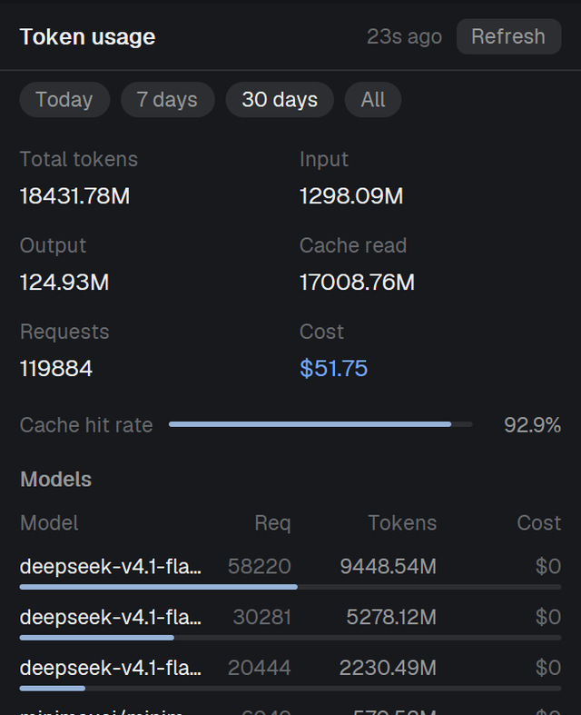

# Token usage

A panel that adds up what your coding agents have spent. It reads the omp session
store — every `*.jsonl` under `~/.omp/agent/sessions` — and shows the range you pick
(Today / 7 days / 30 days / All): total tokens, input, output, cache read, requests and
cost, the cache hit rate, the heaviest models and the projects they ran in. It indexes
in the background in small bites, so the panel stays responsive while it walks a store
of gigabytes, and it says what it is doing in one footer line. It is built to sit in a
narrow docked column (260–760 px) and to also open as a 560×460 overlay.



## What you see

Top to bottom, in a column on the theme's `surface`:

- **Header**, 38 px tall, 12 px side padding, a 1 px `border` line under it. Left: the
  title `Token usage` (12.5 px, semibold, `foreground`). Middle: a right-aligned stamp
  (11.5 px, `dim`, truncating) saying when the index last moved: `just now`, `25s ago`,
  `3m ago`, `2h ago`, `4d ago`. Right: a `Refresh` pill, 20 px tall, 8 px padding,
  radius 6, `raised` background, 11.5 px `muted`; hovering turns it `hover`/`foreground`.
- **Range chips**, 6 px above and below: four pills 20 px tall, 9 px padding, radius 10,
  11.5 px — `Today`, `7 days`, `30 days`, `All`. The chosen one is `selected` background
  with `foreground` text; the others `raised` with `muted` text and a `hover` background
  on hover.
- **Scroll area** (the middle, 12 px side padding, 8 px between blocks):
  - **Stat tiles**, three rows of two: `Total tokens` / `Input`, `Output` / `Cache read`,
    `Requests` / `Cost`. Each is an 11.5 px `dim` label over a 13 px value; `Cost` is
    `done`-colored when it is above zero, `dim` otherwise. Values truncate, they never wrap.
  - Under them, while it applies, one 11.5 px `dim` line: `Active session numbers lag up
    to 1 minute`.
  - **Cache hit rate**: the label, a 3 px rounded bar (track `raised`, fill `accent`, width
    = cache read ÷ (input + cache read)) and a 42 px right-aligned percentage.
  - **Models**: the title, a header row (`Model`, `Req`, `Tokens`, `Cost` — the three
    numbers in fixed 44/76/64 px columns so they line up), then up to 8 rows: the model
    name truncating, its requests, its tokens (`1.24M`, `128k`), its cost (`done`-colored
    when above zero), each with a 3 px `accent` bar under it as wide as the model's share
    of the range's total tokens. Empty: `No model data in this range`.
  - **Projects**: the title, then up to 6 rows 18 px tall: the folder the sessions ran in
    (with your home folder written as `~`, truncating), its tokens and its requests as
    `118820 req`. Empty: `No project data in this range`.
- **Footer**, 26 px, a 1 px `border` line above, one 11.5 px `dim` line that truncates.

Every color comes from `theme()` by name, so the panel follows light and dark themes and
any `colors` override. Nothing is animated and nothing moves except the bars, which
change with the numbers.

## How it behaves

- **One copy per place it is shown** (the docked block, the overlay) shares only the
  chosen range, through `shared("token-usage.range")`; every copy shows the same range.
  Clicking a chip sets it; every copy re-renders.
- **`Refresh`** gives up on every read in flight (each is recorded as failed and counted),
  drops the queue and starts a fresh round immediately, instead of waiting for a tick.
- **A 30 s tick** (`cx.timer.every`) drives everything, and a tick never waits for
  anything: it asks for a fresh listing if none is in flight, gives up on reads older than
  90 s, refills the read queue, starts reads while there are free slots, and writes the
  cache if it is dirty and 15 s have passed since the last write. A tick that finds
  nothing to do still restamps the header, which is how you can see the cadence is alive.
- **Indexing** reads 3 files at once, newest mtime first, and only files whose size or
  mtime differs from the cache — except a file never indexed before, which is never
  budget-limited (a first index of the whole store could otherwise never finish). Re-reads
  stop for the rest of the pass after 6 MiB; a file over 8 MiB whose mtime is younger than
  60 s is left alone (an active session being written); one read is given up on at 90 s and
  the file it was on is blamed so the cadence recovers by itself; a read past 20 s, or a
  walk past the 20 s it is given after the text arrives, counts that file as failed or only
  partly indexed. A failed file keeps the size and mtime the listing reported and the
  buckets already known, so it stops counting as pending.
- **States**, all of them in the footer and the header stamp:
  - `Indexing 3/7 files` while the pass has work left (the numbers are this pass's work,
    not the store's size); otherwise `Indexed 1348 files · 1.8 GB`.
  - `N large file(s) waiting to settle (active sessions)` while big live files are skipped.
  - `N file(s) failed to read`, `N file(s) only partly indexed`.
  - `a read has been running 52s` once a slot has been stuck over 45 s.
  - `listing 47s stale` when the last listing is over 120 s old, and `session store listing
    failed` when the listing command itself failed.
  - `waiting to index` in the header before the first index lands.
  - The footer is one truncating line, so in a 260 px column you see only its first part.
- **Empty store**: if `~/.omp/agent/sessions` does not exist, the panel draws just its
  title and `No omp session data found (~\.omp\agent\sessions)`, and keeps looking.
- **Ranges**: bucket keys are `YYYY-MM-DD|<model>|<provider>`, cut by a string compare
  against the floor — Today (today's local date), 7 days (now − 6 days), 30 days (now −
  29 days), All (no floor). A range's totals are recomputed when the range, the local day
  or the data changes, and kept in between.

## Built from

- `mods/token-usage/main.js` — the View: the indexer (listing, queue, reads, cache) and
  the whole panel.
- `mods/token-usage/store.js` — the plain logic, no imports, so the same parsing runs in
  a bare JS runtime: `RANGES`, `dayKey`, `rangeFloor`, `scan` (one file's text → per-day
  per-model buckets), `projectOf`, `aggregate`, `topModels`, `topProjects`, `fmtTokens`,
  `fmtBytes`, `fmtCost`, `fmtAgo`.
- `mods/token-usage/mod.json` — `{"place":"none","overlay":{"width":560,"height":460}}`:
  the layout decides where the docked copy sits; `mod.open` gets the 560×460 overlay.
- `herdr` functions used: `theme()`, `shared()`/`setShared()` (one key,
  `token-usage.range`), `home()`, `appHome()`, `window()` (only `.platform`, to pick the
  lister), `exec()`. From `gpui-kit`/`gpui-base`: `View`, `div`, `v_flex`, `h_flex`, and
  `cx.spawn`, `cx.timer.every`, `cx.timer.after`, `cx.notify`.
- **Data source: the omp session store**, `~/.omp/agent/sessions/**/*.jsonl` — omp's own
  session logs, one JSON line per event. The `type:"session"` line near the top carries
  the `cwd`; only `type:"message"` lines with a `message.usage` and a numeric
  `message.timestamp` are counted, into `[requests, input, output, cacheRead, cacheWrite,
  cost]` per `day|model|provider`. `~/.omp/stats.db` is stale on this setup and must
  **not** be used. Nothing else is read: no `hc`, no network, no other database.
- **Persistence**, both plain JSON rewritten whole: `~/.config/herdr-app/data/token-usage/
  cache.json` (`{"v":1,"files":{"<path>":{"s":<size>,"m":<mtime ms>,"b":{<day|model|provider>:
  [req,in,out,cacheRead,cacheWrite,cost]}}}}`) and `projects.json` (`{"v":1,"dirs":
  {"<project folder>":"<cwd>"}}`). They are written in that order, every 15 s at most, and
  a cut-short file is tolerated: it fails to parse and the index starts empty.
- **Programs it runs**, one listing per ~30 s, for size and mtime of every session file:
  - Windows: `powershell -NoProfile -NonInteractive -Command "$ErrorActionPreference=
    'SilentlyContinue'; Get-ChildItem -LiteralPath <store> -Recurse -File -Filter *.jsonl |
    ForEach-Object { $_.FullName + [char]9 + $_.Length + [char]9 + [long](($_.LastWriteTimeUtc
    - [datetime]'1970-01-01T00:00:00Z').TotalMilliseconds) }"`.
  - Other platforms: `find <store> -type f -name *.jsonl -printf "%p\t%s\t%T@\n"`.
- Cost math: `cost.total` when the session recorded one, else input + output + cache read +
  cache write. Total tokens = input + output + cache read + cache write. Hit rate = cache
  read ÷ (input + cache read).

## Watch out

- **`fs/promises` here is not Node's.** It has no `stat`, no `appendFile`, no `open` — so
  size and mtime can only come from the `exec` listing above (reading 1.8 GB to notice one
  change is no answer), and the cache is rewritten whole.
- **The fs bridge is slow under load**: 0.7–17 s for a 340 KB read or write has been
  measured, and `cx.timer.after` fires late too. That is why every await races a timer, the
  tick never awaits anything, and the bounds are advisory rather than guarantees. One stuck
  read costs one of the three slots, not the panel.
- **The number the person should know**: an active session is written continuously, so it
  keeps hitting the 8 MiB / 60 s rule and only its last good numbers are shown — the current
  session's totals lag by up to about a minute. The line under the tiles says so while it
  applies. Everything else is exact.
- **A fresh copy starts cold**: nothing is indexed until the first listing answers, and the
  first pass reads every file it has never seen without the byte budget. `herdr-app check`,
  a newly added layout or a fresh overlay all start empty and show `0` for a few seconds.
- **Counts are about this pass and this copy**, not the store: `Indexing 3/7 files` is this
  pass's work. There is no cap on how many files a pass queues; 3 slots, the 6 MiB re-read
  budget and the 20 s read bound are what pace it.
- **The listing is a real process** — `powershell` on Windows — started about every 30 s and
  never waited on (`find` elsewhere). It is its own cost on a big store.
- **Constants worth keeping**: 30 s tick, 15 s write interval, 20 s read bound, 6 MiB re-read
  per pass, 8 MiB / 60 s big-file deferral, 90 s give-up, 25 s listing bound, 3 concurrent
  reads, `exec`'s own 30 s / 8 MiB limit, 8 models, 6 projects.
- **Assumptions**: the lines of a session file are JSON, one per line, and the usage lives
  in `message.usage`; the store's items are `.jsonl` files; `~` in the store path means the
  user's home. Sessions with no `message.timestamp` are skipped rather than guessed at.
- **Only two controls**: the chips and `Refresh`. No key is bound, nothing opens, and no
  agent status (`working` / `blocked` / `done` / `idle`) is drawn here — the only place a
  status color appears is a non-zero cost, drawn in the theme's `done` color.
- Numbers are laid out for a 260–760 px column; the fixed numeric columns keep them from
  wrapping, and below that the tiles start truncating.

## Done when

- `herdr-app check ~/.config/herdr-app/mods/token-usage` prints `check passed` (it loads
  the mod and renders it once; run it after every edit).
- `herdr-app do layout.show '{"id":"token-usage"}'` then `herdr-app shot /tmp/tu.png` shows
  the panel with English everywhere and no wrapped or clipped numbers at 329 px, 400 px and
  560 px (`herdr-app do layout.resize '{"id":"sai-panel","px":400}'`).
- `herdr-app do mod.open '{"name":"token-usage"}'` opens the 560×460 overlay; Esc or
  `herdr-app do overlay.close '{}'` closes it. A just-opened copy shows `0` and
  `Indexed 0 files · 0 B` for a few seconds, then fills in — that is the cold start, not a
  failure.
- The numbers check out against an independent count. Take the store
  (`~/.omp/agent/sessions/**/*.jsonl`), parse the same lines with a second implementation,
  and compare: with the shipped `store.js` driven directly by Node
  (`node --input-type=module -e "import {scan,aggregate} from '.../mods/token-usage/store.js'"`)
  and an independent Python walk of the same rules, per-file digests of the buckets are
  identical for every file that is not being written, and the four range totals agree to
  the byte apart from the live sessions — 1346 of 1348 files matched on this store, the two
  that differed being the running session and its sub-agents' files.
- The panel's own footer tells the truth: while it says `Indexing k/n files` the totals
  trail the fresh count, and when it settles to `Indexed N files · …` the totals match that
  fresh count exactly.

## Install

`mod.json` says `"place":"none"`, so it only appears where a layout or another mod puts it.
Dock it as a right-hand column: the column has a stack, one stack child is this mod's
block, and a sibling is `active` (the stack shows one child; the header the layout draws
can switch between them):

```json
{ "id": "sai-panel", "type": "column", "size": { "px": 400 }, "min": 260, "max": 760,
  "children": [
    { "id": "sai-panel-body", "type": "stack", "active": "token-usage",
      "children": [
        { "id": "token-usage", "type": "block", "content": { "mod": "token-usage" } }
      ] } ] }
```

Hide and show it with `herdr-app do layout.hide '{"id":"token-usage"}'` and
`herdr-app do layout.show '{"id":"token-usage"}'`. The overlay is
`herdr-app do mod.open '{"name":"token-usage"}'` at 560×460.

One trap when the block sits in a stack: the app records a stack child you switch away from
as `hidden`, and `layout.select` does not clear that. Showing such a panel back takes three
commands — the select, the child, then the column:

```sh
herdr-app do layout.select '{"stack":"sai-panel-body","child":"token-usage"}'
herdr-app do layout.show   '{"id":"token-usage"}'
herdr-app do layout.show   '{"id":"sai-panel"}'
```

